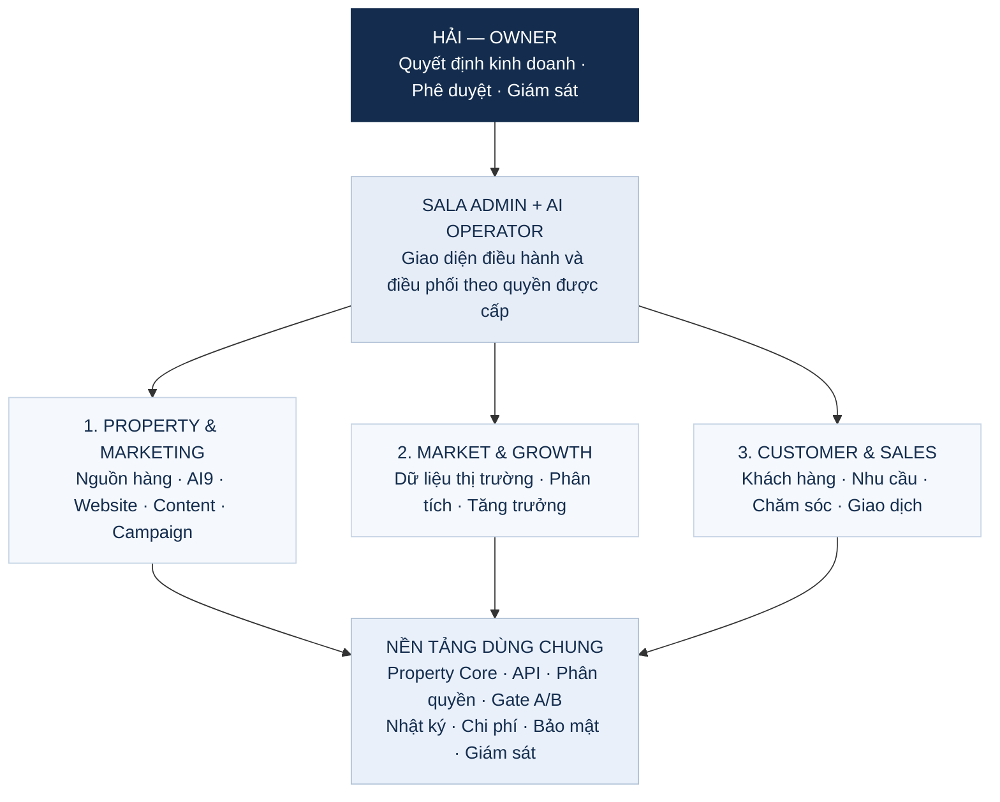
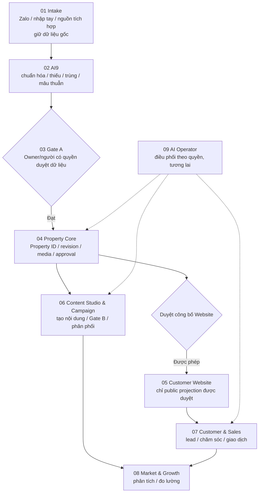
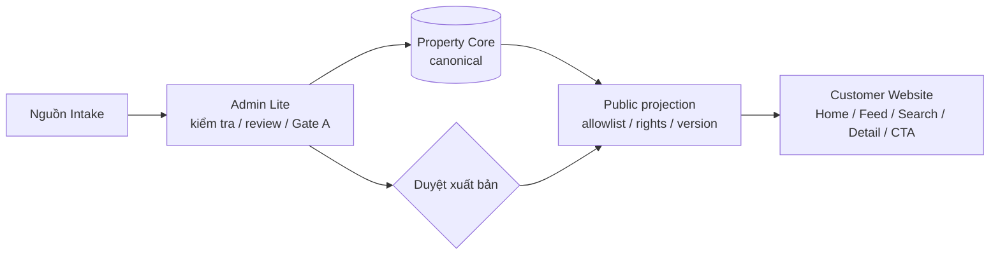

# SALA BĐS — MASTER SYSTEM & WEB FIRST BLUEPRINT V1.0
**Owner-approved architecture reference | 18/11/2026 | Design target, not implementation evidence**

> **Phạm vi:** Chỉ SALA BĐS, repository `Haisala/sala-bmt-listings`. Tài liệu Markdown này chuyển tải cấu trúc và quyết định nghiệp vụ từ bản PDF **SALA_BDS_MASTER_SYSTEM_WEB_FIRST_V1.pdf** đã được Owner duyệt. Không được dùng tài liệu thiết kế để tự khẳng định code, staging hay production đã PASS. Không áp kiến trúc SALA Media cho SALA BĐS.

## A1. SƠ ĐỒ KIẾN TRÚC TỔNG THỂ — ĐÃ CHỐT

**Diễn giải bắt buộc:** Ba khối là **bộ phận/nghiệp vụ**, không mặc định ba microservice hay ba repository. AI Operator là năng lực điều phối tương lai, không phải ứng dụng mới bắt buộc triển khai ngay. Một hệ thống SALA BĐS, **một Property Core canonical** (kho dữ liệu BĐS chuẩn duy nhất).

## A2. Mục tiêu và nguyên tắc

- Một BĐS được tiếp nhận có nguồn → kiểm tra → phê duyệt → lưu thành hồ sơ chuẩn; các bộ phận khai thác dữ liệu theo quyền.
- Không tạo hệ thống BĐS hoặc Property Core thứ hai cạnh tranh nguồn dữ liệu hiện có.
- **Web First:** Website khách hàng và Admin Lite đi trước AI Content, Campaign, CRM hoàn chỉnh.
- AI không tự bịa dữ kiện, không vượt quyền duyệt, không vượt ngân sách; có nhật ký và truy vết.
- Ảnh/media phải có nguồn, quyền sử dụng và lịch sử; dữ liệu công khai chỉ là tập trường được phép.
- Mọi kết luận về hoàn thành phải dựa vào bằng chứng theo môi trường, không suy từ sơ đồ.

## A3. Luồng kinh doanh tổng thể

**Các cổng không được gộp:** Gate A = duyệt dữ liệu vào Core; duyệt Website = cho phép công bố public; Gate B = duyệt nội dung và quyền phân phối theo hợp đồng nghiệp vụ. Quy trình cụ thể phải đối chiếu code hiện có trước khi đề xuất thay đổi.

## A4. PROPERTY & MARKETING

| Năng lực | Đầu vào / xử lý / đầu ra | Ranh giới |
|---|---|---|
| Intake | Tin nhắn, mô tả, giá, ảnh, vị trí, nguồn liên hệ → lưu bản gốc, mã tiếp nhận, thời điểm, quyền → hồ sơ intake | Intake chưa phải Property Core; không tự công bố |
| AI9 | Trích xuất, chuẩn hóa, phát hiện thiếu/trùng/mâu thuẫn/cảnh báo | **9 lớp nghiệp vụ không có nghĩa 9 API calls** |
| Gate A | Kiểm thông số, giá, nguồn, ảnh, quyền, độ tin cậy, trường bắt buộc | Chỉ dữ liệu đạt điều kiện mới vào Core |
| Property Core | Property ID ổn định, loại/diện tích/giá/địa điểm, media, revision, approval, public data | Đây là mô hình logic; không khẳng định tên cột DB |
| Customer Website | Xem bản public đã duyệt | Không đọc private fields, không tự sửa Core |
| Content Studio | Tạo nội dung có căn cứ từ BĐS chuẩn | Chưa coi offline tests là live AI PASS |
| Campaign | Duyệt nội dung → kênh → lịch → phân phối → đo lường | Facebook/TikTok/Zalo/search là hướng tích hợp, không mặc định đã hoạt động |

## A5. MARKET & GROWTH

Thu thập tín hiệu nguồn hàng/thị trường/chiến dịch → chuẩn hóa dữ liệu so sánh → phân tích xu hướng giá, cung cầu → đề xuất khu vực/phân khúc → đo lường hiệu quả. **Giá chào bán không tự coi là giá giao dịch**; kết luận phải có nguồn, thời điểm, độ tin cậy.

## A6. CUSTOMER & SALES

Lead (khách quan tâm) → Customer Profile (nhu cầu/ngân sách/lịch sử) → Matching (gợi ý BĐS phù hợp) → Follow-up (phản hồi/lịch hẹn) → Deal Pipeline (xem nhà/thương lượng/giao dịch) → Feedback. Web First chỉ cần liên hệ hoạt động đúng; **CRM hoàn chỉnh không phải điều kiện bắt buộc ra mắt**. Dữ liệu khách hàng có phân quyền/mục đích sử dụng.

## A7. AI OPERATOR

Owner yêu cầu → kiểm tra Property Core và quyền → lập kế hoạch/dự toán → trình duyệt → thực thi được phép → theo dõi. Không tự sửa dữ kiện BĐS, bỏ qua phê duyệt, vượt chi phí, công bố/xóa/đổi quyền ngoài phạm vi. Tích hợp dần, không xây ứng dụng mới chỉ vì có ô AI Operator trên sơ đồ.

## A8. NỀN TẢNG DÙNG CHUNG

Property Core & API; Identity & Access (danh tính/phân quyền); Approval (duyệt); Media & Rights (nguồn/quyền); Audit Log (nhật ký); Usage Ledger (chi phí AI); Monitoring (giám sát); Backup & Recovery (sao lưu/phục hồi). Tận dụng nền tảng đang tồn tại, không tạo bản sao.

## A9. Lộ trình năng lực toàn hệ thống

1. **Web First:** Website + Admin Lite + dữ liệu công khai.
2. **AI & Content:** AI9, Content Studio, kiểm soát chi phí AI.
3. **Marketing:** Campaign, phân phối, đo lường.
4. **Customer & Sales:** CRM, chăm sóc, giao dịch.
5. **Market & Growth:** phân tích, tăng trưởng.
6. **AI Operator:** điều phối liên bộ phận.

Đây là **thứ tự ưu tiên hoàn thiện năng lực**, không phải lệnh xây lại các thành phần đã có.

---

# B. WEB FIRST — GIAI ĐOẠN 1 ĐÃ CHỐT

**Đích:** Owner quản lý/duyệt BĐS trên Admin; khách tìm/xem/liên hệ trên Website; hai giao diện cùng dùng Property Core. Không chờ Content, Campaign, CRM hoàn chỉnh.

## B1. Các thành phần

- **Customer Website:** Home, Feed, Search, Filter, Detail, CTA, Footer; mobile-first, tham chiếu iPhone 15 Pro Max; thương hiệu **SALA - BĐS** navy/trắng, logo S custom đã chốt.
- **Admin Lite:** Dashboard; Property List; Property Detail & Media; Approval & Publication. Tận dụng Admin và các màn hình kỹ thuật/AI đã có, không xóa hoặc xây lại tùy tiện.
- **API + Property Core:** nguồn chuẩn, phiên bản, quyền, media, dữ liệu công khai.
- **Hạ tầng hiện có:** tái sử dụng sau audit; không lập kho dữ liệu chuẩn thứ hai.

## B2. Vai trò

- **Owner:** quyết định mục tiêu, dữ liệu, giao diện, phê duyệt phát hành.
- **ChatGPT:** phân tích, điều phối, kiểm chứng và đối chiếu bằng chứng.
- **ChatGPT Sites:** tạo mẫu trực quan cho thay đổi thiết kế lớn khi cần.
- **Codex:** tích hợp đúng thiết kế, kiểm thử, báo cáo theo quyền được giao.
- **GitHub:** nguồn quản trị nhiệm vụ và bằng chứng kỹ thuật; Preview (bản xem trước) để Owner duyệt, production chỉ sau chấp thuận.

## B3. Quy trình thiết kế Website

Yêu cầu → phân biệt chỉnh nhỏ hay thay đổi lớn → Sites tạo phương án khi cần → Owner chọn và khóa **Visual Master** (mẫu giao diện chuẩn, ảnh tham chiếu, kích thước, responsive, assets) → Codex tích hợp trên component hiện hữu → kiểm thử hiển thị/chức năng → Owner duyệt Preview → bảo vệ phần đã chốt. **Không redesign (thiết kế lại) toàn trang chỉ vì sửa một thành phần.** Hero vệt phải và Footer đã có mẫu Owner chọn; cần đối chiếu bằng chứng handoff trước khi kết luận đã tích hợp đúng.

## B4. Quy trình một BĐS mới

1. Nhận nguồn, ảnh, giá, mô tả; giữ nguyên bản gốc.
2. Lưu Intake có mã, nguồn, thời điểm, media.
3. AI9 chuẩn hóa, không tự suy diễn.
4. Chống trùng và đối chiếu identity/provenance.
5. Kiểm tra media rights, citations và trường bắt buộc.
6. Tạo hồ sơ Review để người có quyền xem.
7. Gate A duyệt dữ liệu hợp lệ; thiếu chứng cứ phải fail-closed (chặn an toàn).
8. Ghi/đổi phiên bản Property Core chuẩn, không ghi đè âm thầm.
9. Tạo public projection chỉ gồm trường được phép.
10. Xem trước thông tin BĐS trên Website.
11. Duyệt công bố riêng, không đồng nhất Gate A với public publish.
12. Kiểm tra Website hiển thị đúng bản được duyệt; lưu bằng chứng.

**Tình huống cập nhật:** đổi giá, đổi ảnh, trạng thái đã bán/ngừng bán phải có nguồn, version, quyền duyệt, cập nhật public projection có kiểm soát; không để Website tiếp tục quảng cáo thông tin lỗi thời.

## B5. Môi trường và an toàn

- Local (máy phát triển) ≠ staging (môi trường thử nghiệm) ≠ production (vận hành chính thức).
- Không suy login PASS từ HTTP health 200; không suy production PASS từ test isolated.
- Không công bố private fields, ảnh chưa có quyền hoặc nội dung chưa duyệt.
- Không tự thay DNS, tunnel, secrets, chi phí AI, dữ liệu thật, quyền người dùng hoặc xuất bản.

---

# C. WEB FIRST — 8 GATE TRIỂN KHAI VÀ NGHIỆM THU

| Gate | Việc cần đạt | Bằng chứng yêu cầu |
|---|---|---|
| 0 — Read-only Audit | Kiểm kê đúng repo, source, tests, issue, runtime | Ma trận trạng thái và nguồn cụ thể |
| 1 — Visual Master | Đối chiếu thiết kế Owner đã khóa | Ảnh tham chiếu, viewport, Owner acceptance |
| 2 — Website | Hoàn thiện các trang và hành vi trong phạm vi | UI/functional tests, Preview |
| 3 — Admin Lite | Quản lý, kiểm tra, duyệt, công bố đúng quyền | Tests + staging E2E |
| 4 — Core Integration | Một Core → public projection → Website | Bằng chứng bản ghi và quyền xuyên suốt |
| 5 — E2E | Intake → Review → Core → Website, cả lỗi/replay/rollback | Execution/test receipts |
| 6 — Production Readiness | DNS/TLS, auth, backup, monitor, deploy allowlist, rollback | Run/artifact evidence |
| 7 — Owner Acceptance | Owner duyệt phát hành và nghiệm thu | Quyết định/biên bản cụ thể |

**Quy tắc:** không được coi Web First hoàn thành là toàn bộ SALA BĐS hoàn thành; không nhảy gate khi thiếu bằng chứng; giữ phần đã PASS, chỉ xử lý khoảng trống.

## C2. Ranh giới thực thi

Không chạm SALA Media/NaviBDS hay hệ thống khác. Không tạo Property Core thứ hai, không thiết kế lại UI đã khóa, không xóa/sửa dữ liệu thật, không publish hay gọi AI tốn phí nếu chưa được Owner cho phép. Không biến yêu cầu audit thành quyền sửa code.

## C3. Mẫu báo cáo Codex

Mục tiêu; commit SHA + môi trường; trạng thái `PASS/PARTIAL/BLOCKED/FAIL/UNKNOWN`; bằng chứng file/line/test/run/issue; phạm vi đã kiểm; phần còn thiếu; tác động tới thành phần cũ; **một** việc ưu tiên tiếp theo. Tách `DESIGNED`, `CODE_EXISTS`, `TESTED`, `STAGING_VERIFIED`, `PRODUCTION_VERIFIED`.

---

# D. QUYẾT ĐỊNH ĐÃ CHỐT VÀ NGUYÊN TẮC ĐỐI CHIẾU

1. Một SALA BĐS thống nhất; một canonical Property Core.
2. Ba bộ phận nghiệp vụ: Property & Marketing; Market & Growth; Customer & Sales; nền tảng dùng chung.
3. Web First là ưu tiên hiện tại; Admin Lite + Website + Core cùng nguồn.
4. AI Operator là giai đoạn sau, có quyền hạn và ngân sách.
5. Owner khóa thiết kế; Codex chỉ tích hợp đúng phần được giao.
6. GitHub chứa bằng chứng, không thay thế nghiệm thu runtime/Owner.
7. Giữ nguyên thành quả hiện hữu; không xây lại vì sơ đồ đích có tên khác code hiện tại.
8. Dữ liệu, ảnh, quyền và công bố đi qua các cổng kiểm soát.

## D2. HƯỚNG DẪN CODEX: AUDIT AGAINST LATEST BLUEPRINT

Đây là **nguồn thiết kế mới nhất cho việc đối chiếu Issue #39**, ưu tiên hơn các bản V4/MASTER_ARCHITECTURE cũ **chỉ ở chỗ mô tả kiến trúc mục tiêu và phạm vi Web First**. Các nguồn cũ vẫn có giá trị về code, lịch sử, contract đã khóa nếu không mâu thuẫn với quyết định Owner mới. Nếu có mâu thuẫn, liệt kê để Owner quyết, không tự sửa.

Audit theo 3 cột: **(a) mục tiêu ở tài liệu này, (b) code/bằng chứng đang có, (c) khoảng cách tối thiểu**. Với từng chức năng, đánh dấu: `REUSE_AS_IS`, `REUSE_WITH_INTEGRATION`, `MISSING`, `UNKNOWN`, `CONFLICT`. Trước khi đề xuất viết mã, kiểm tra xem đã có module/API/schema/test giải quyết đúng chức năng chưa. **Không yêu cầu viết lại hoặc di chuyển kiến trúc chỉ để khớp tên các ô trong sơ đồ.**

**Bằng chứng Issue #39 trước khi cập nhật:** Codex đã phát hiện Website đọc `data/listings.json` tĩnh, còn public projection từ Core chưa nối vào public site; cũng báo rủi ro hai Pages workflow và chưa có chứng minh artifact thực tế. Đây là phát hiện audit **PARTIAL**, không phải quyết định triển khai. Cần tiếp tục xác minh và phân loại theo blueprint mới; không mặc định kết luận cũ là toàn diện.

**Tình trạng tài liệu:** Đã được Owner duyệt ở cấp **kiến trúc và hướng đi**. Không được suy ra Owner duyệt triển khai production, chi phí AI, thay đổi dữ liệu hay sửa mã nguồn. Nếu cần độ chính xác của các trang dàn trang, tham chiếu bản PDF Owner giữ; Markdown này là bản đọc được trên GitHub cho Codex, không phải bản thiết kế giao diện pixel-perfect.
